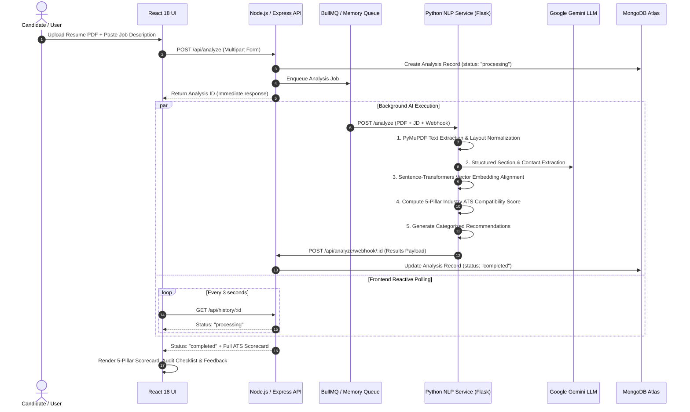

<div align="center">
  
  
  <br />
  <br />

  <h1>⚡ ResumeIQ — Smart ATS Resume Analyzer & Career Optimizer</h1>

  <p>
    <strong>Enterprise-grade, full-stack AI platform providing multi-pillar ATS compatibility scoring, automated parseability audits, and categorized resume recommendations tailored to target job descriptions.</strong>
  </p>

  <p>
    <a href="#-key-features"><strong>Explore Features</strong></a> ·
    <a href="#-industry-standard-ats-scoring-architecture"><strong>5-Pillar Scoring Model</strong></a> ·
    <a href="#-system-architecture"><strong>Architecture</strong></a> ·
    <a href="#-quick-start"><strong>Installation</strong></a> ·
    <a href="#-api-reference"><strong>API Docs</strong></a>
  </p>

  <br />

  
  
  
  
  
  <br />
  
  
  
  
  
</div>

---

## 🌟 Overview

Most generic resume screeners rely on naive keyword counts or unnormalized vector similarity that penalizes strong candidates. **ResumeIQ** mimics real-world enterprise Applicant Tracking Systems (**Jobscan**, **Workday**, **Lever**, and **Taleo**). 

It combines **Google Gemini LLM structured parsing**, **SentenceTransformers (`all-MiniLM-L6-v2`) embeddings**, and a **Weighted 5-Pillar Evaluation Algorithm** to give candidates an accurate ATS score (0–100), deep gap analysis, and actionable bullet-by-bullet feedback.

---

## 🎯 Key Features

### 1. 🧮 Multi-Pillar Industry ATS Compatibility Scorecard
* **Weighted Multi-Factor Scoring**: Evaluates candidate qualifications across 5 weighted pillars instead of raw text distance.
* **Score Tiers**: Automatically classifies matches into *Exceptional Match* (85–100), *Strong Match* (70–84), *Good Match* (50–69), and *Needs Optimization* (<50).
* **Animated Score Ring & Mini Progress Bars**: Visualizes granular performance across all evaluation pillars.

### 2. 🛡️ ATS Parseability & Format Health Audit
* Runs an automated 5-point checklist checking:
  - ✅ Standard ATS section header detection (*Experience*, *Education*, *Skills*, *Projects*).
  - ✅ Contact information completeness (Name, Email, Phone, LinkedIn, GitHub).
  - ✅ Clean digital text extraction layer (PyMuPDF with two-pass reading flow).
  - ✅ Single-stream parse flow (no table or layout corruption).
  - ✅ Quantified metrics density (numbers, percentages, scale, benchmarks).

### 3. 💡 Categorized, Actionable Recommendations
No generic cover letter advice or irrelevant fluff. Feedback is categorized into:
* 🎯 **Keyword Strategy & Placement**: Direct advice on placing core keywords in both the Skills section and top experience bullets for algorithm weighting.
* 📊 **Quantifiable Impact (Google X-Y-Z Formula)**: Highlights achievement bullets that lack measurable impact (*Accomplished [X] as measured by [Y] by doing [Z]*).
* ⚡ **Action Verb Power**: Identifies passive phrasing and recommends strong engineering verbs (*Architected*, *Engineered*, *Optimized*, *Spearheaded*).
* 🛡️ **ATS Compliance**: Verifies layout readability and heading structure.

### 4. 🔍 Complete Resume Section Extraction (Zero Skipping)
* **Candidate Header**: Verified email, phone, location, LinkedIn, GitHub, and portfolio links.
* **Professional Summary**: Extracted and preserved with proper whitespace.
* **Work Experience**: Structured roles, company names, durations, locations, and achievement bullet points.
* **Education**: Degree, university/institution, graduation year, and GPA.
* **Technical Projects**: Name, live repository links, descriptions, and technology stack badges.
* **Certifications, Languages & Achievements**: Cataloged with distinct visual badges.

### 5. 🛡️ Production-Grade Reliability & Fault Tolerance
* **React 18 ErrorBoundary**: Dedicated fallback handling preventing unmounted "black screens" on unexpected runtime data.
* **Dual-Mode Queue Processing**: BullMQ with Redis support with automatic, zero-configuration in-memory asynchronous fallback.
* **Defensive Data Sanitization**: `safeUrl()` and `safeText()` handlers guaranteeing error-free rendering.

---

## 📊 Industry-Standard ATS Scoring Architecture

| Pillar | Weight | Description & Methodology |
| :--- | :---: | :--- |
| **1. Skills & Keywords Match** | **40%** | Exact & semantic match ratio between required JD skills and candidate resume skills. |
| **2. Experience & Role Alignment** | **25%** | Seniority level, role titles, internship relevance, and semantic bullet alignment. |
| **3. Education & Credentials** | **15%** | Relevant degree (e.g. Computer Science / Engineering), coursework, honors, GPA. |
| **4. Content Impact & Action Verbs** | **10%** | Density of quantifiable metrics (`%`, `ms`, scale, throughput) + high-impact power verbs. |
| **5. ATS Format & Parseability** | **10%** | Digital text parseability, complete contact information, and standard section headers. |
| **Total Compatibility Score** | **100%** | **Comprehensive ATS Compatibility Rating (0 – 100)** |

---

## 🔄 System Architecture



---

## 📁 Repository Structure

```text
smart-resume-analyzer/
├── backend/                       # Node.js + Express REST API
│   ├── config/                    # MongoDB connection configuration (db.js)
│   ├── controllers/               # Route logic (analyze, auth, history)
│   ├── middleware/                # JWT auth and global structured error handling
│   ├── models/                    # Mongoose models (User.js, Analysis.js)
│   ├── queue/                     # Resilient BullMQ + in-memory job worker
│   ├── routes/                    # API endpoints (/api/analyze, /api/auth, /api/history)
│   ├── tests/                     # Jest & Supertest integration tests
│   ├── server.js                  # Express server entry point
│   └── package.json
│
├── nlp-service/                   # Python AI & NLP Microservice
│   ├── app.py                     # Flask service, 5-Pillar scoring, LLM parser
│   ├── requirements.txt           # PyMuPDF, sentence-transformers, google-generativeai
│   └── .env                       # Gemini API key & Flask configuration
│
└── frontend/                      # React 18 + Vite + Tailwind CSS Dashboard
    ├── src/
    │   ├── components/
    │   │   ├── DropZone.jsx       # Drag-and-drop resume PDF uploader
    │   │   ├── ErrorBoundary.jsx  # React Error Boundary crash protection
    │   │   ├── HistoryCard.jsx    # Past analysis card with score badges
    │   │   ├── Navbar.jsx         # Responsive navigation & user profile
    │   │   ├── ResultsPanel.jsx   # 5-Pillar ATS scorecard & audit view
    │   │   ├── ScoreRing.jsx      # Animated SVG circular ATS score gauge
    │   │   └── Spinner.jsx        # Loading indicator
    │   ├── pages/
    │   │   ├── Dashboard.jsx      # Main analysis & history dashboard
    │   │   ├── Login.jsx          # User authentication login view
    │   │   └── Register.jsx       # User registration with password confirm
    │   ├── context/               # AuthContext state management
    │   └── utils/                 # Axios instance with interceptors (api.js)
    ├── tailwind.config.js
    └── package.json
```

---

## 🚀 Quick Start

### Prerequisites
* **Node.js** v18+ & **npm**
* **Python** v3.10+
* **MongoDB** (Local instance or MongoDB Atlas URI)
* **Google Gemini API Key** (Get free from [Google AI Studio](https://aistudio.google.com/))
* *(Optional)* **Redis** (If using Redis BullMQ; otherwise in-memory mode runs automatically)

---

### Step 1: Start the NLP Microservice

```bash
cd nlp-service

# Create and activate virtual environment
python -m venv venv

# macOS / Linux:
source venv/bin/activate
# Windows:
.\venv\Scripts\activate

# Install dependencies
pip install -r requirements.txt
```

Create `nlp-service/.env`:
```env
PORT=5001
GEMINI_API_KEY=your_gemini_api_key_here
FLASK_ENV=development
```

Start the Python service:
```bash
python app.py
```
> Running on `http://localhost:5001`. *(On first boot, `sentence-transformers/all-MiniLM-L6-v2` will download automatically).*

---

### Step 2: Start the Backend API

```bash
cd backend
npm install
```

Create `backend/.env`:
```env
PORT=5000
MONGO_URI=mongodb://localhost:27017/resume-analyzer   # Or MongoDB Atlas URI
JWT_SECRET=your_jwt_secret_key_here
NLP_SERVICE_URL=http://localhost:5001
APP_URL=http://localhost:5000
INTERNAL_NLP_TOKEN=internal_secret_token_123
# Optional Redis:
# REDIS_URL=redis://localhost:6379
```

Run tests to verify backend health:
```bash
npm test
```

Start the backend server:
```bash
npm run dev
```
> Running on `http://localhost:5000`.

---

### Step 3: Start the Frontend UI

```bash
cd frontend
npm install
npm run dev
```
> Open your browser at `http://localhost:5173`.

---

## 📡 API Reference

### Authentication
| Method | Endpoint | Description | Auth |
| :--- | :--- | :--- | :---: |
| `POST` | `/api/auth/register` | Register new user (`name`, `email`, `password`, `confirmPassword`) | Public |
| `POST` | `/api/auth/login` | Login user and obtain JWT token | Public |
| `GET` | `/api/auth/me` | Fetch currently logged-in user profile | Bearer |

### Analysis
| Method | Endpoint | Description | Auth |
| :--- | :--- | :--- | :---: |
| `POST` | `/api/analyze` | Upload resume PDF + job description → enqueues analysis | Bearer |
| `POST` | `/api/analyze/webhook/:id` | Internal webhook receiving completed NLP analysis | Internal Token |
| `GET` | `/api/history` | Paginated history of completed analyses | Bearer |
| `GET` | `/api/history/:id` | Detailed analysis report by ID | Bearer |
| `DELETE` | `/api/history/:id` | Remove analysis from history | Bearer |

### System Health
| Method | Endpoint | Description | Auth |
| :--- | :--- | :--- | :---: |
| `GET` | `/api/health` | Service uptime and MongoDB connectivity check | Public |

---

## 🛡️ Error Handling & Reliability

* **Graceful Degradation**: If Google Gemini rate limits occur, the NLP service automatically falls back to regex-based local text extraction and local sentence embedding similarity, ensuring no job ever fails silently.
* **Crash Protection**: React `ErrorBoundary` wraps results rendering, preventing third-party script crashes or malformed candidate data from breaking the dashboard.
* **Clean Asynchronous Lifecycle**: Temporary PDF uploads are securely scrubbed from the filesystem immediately after extraction.

---

## 🤝 Contributing

Contributions, issues, and feature requests are welcome!
1. Fork the Project
2. Create your Feature Branch (`git checkout -b feature/AmazingFeature`)
3. Commit your Changes (`git commit -m 'feat: add amazing feature'`)
4. Push to the Branch (`git push origin feature/AmazingFeature`)
5. Open a Pull Request

---

## 📄 License

Distributed under the **MIT License**. See `LICENSE` for more information.
