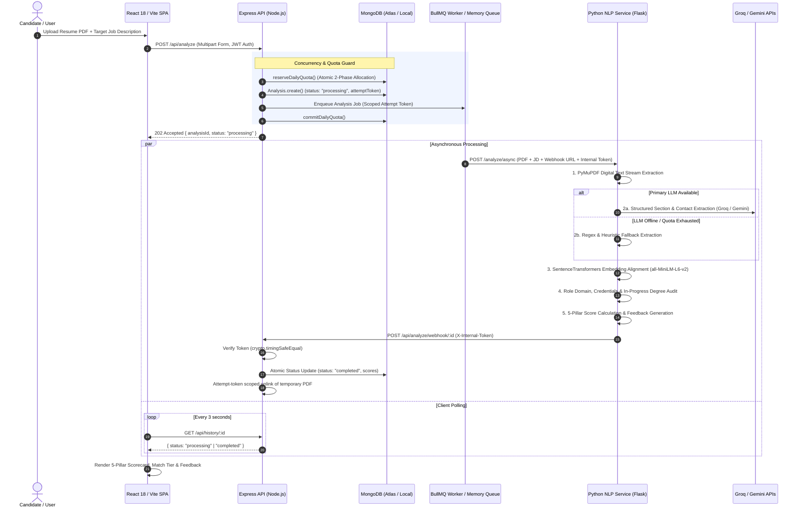

# ResumeIQ — Smart ATS Resume Analyzer & Career Optimizer

ResumeIQ is a production-grade, full-stack resume analysis platform that evaluates candidate resumes against job descriptions using a hybrid architecture of deterministic evaluation, dense vector embeddings, and large language models (LLMs). The platform mirrors modern Applicant Tracking Systems (ATS) by analyzing skill overlap, role relevance, credential requirements, quantifiable impact, and formatting parseability.

---

## Technical Recruiter Fast-Track (30-Second Summary)

* **Role Relevance:** Demonstrates full-stack software development (Node.js/Express, React 18, MongoDB) and AI/ML engineering (Python/Flask, SentenceTransformers, Groq/Gemini LLMs).
* **Core Problem Solved:** Eliminates naive keyword-stuffing exploits and scoring inflation by combining deterministic domain qualification rules, dense semantic similarity, and multi-model LLM structured extraction.
* **Key Distributed Systems & Backend Highlights:**
  * Asynchronous queue processing (BullMQ/Redis with zero-config in-memory fallback) featuring worker attempt-token isolation to prevent race conditions.
  * Two-phase atomic quota reservation (`reserveDailyQuota` -> `commit` / `rollback`) enforcing a 5-submission daily trial per user.
  * Idempotent job submissions guarded by MongoDB partial unique indexing.
  * Authenticated, ownership-validated file delivery replacing unauthenticated static uploads.
  * Fail-closed internal webhook authentication with timing-safe token verification.
* **Key AI/NLP Highlights:**
  * Weighted 5-pillar scoring algorithm (0–100) with mathematical pillar-sum integrity invariants.
  * Role-aware domain qualification and mandatory professional credential validation (e.g., medical licenses, bar admissions).
  * In-progress degree classification (handling expected graduation dates vs. internship or full-time criteria).
  * High-speed inference using Groq (Llama-3.3-70B), graceful fallback to Google Gemini (`gemini-2.5-flash`), and offline SentenceTransformers (`all-MiniLM-L6-v2`).
* **Live Deployments:**
  * **Frontend Web Application:** [https://ai-resume-analyzer-nlp.vercel.app](https://ai-resume-analyzer-nlp.vercel.app)
  * **Backend API Health:** [https://ai-resume-analyzer-nlp-1.onrender.com/api/health](https://ai-resume-analyzer-nlp-1.onrender.com/api/health)
  * **NLP Microservice Health:** [https://ai-resume-analyzer-nlp.onrender.com/health](https://ai-resume-analyzer-nlp.onrender.com/health)

---

## System Architecture



---

## Engineering Highlights

### Software Development & Backend Engineering (SDE)

1. **Attempt-Token Worker Isolation:**
   To prevent stale worker instances or late-arriving retry responses from overwriting newer analysis attempts, each processing run acquires a cryptographically unique `attemptToken`. Status transitions, heartbeat updates, and score persistence queries are conditionally bound to this token (`{ _id: id, attemptToken: token }`). Stale workers match zero documents and are halted without corrupting active records or deleting in-use files.

2. **Two-Phase Atomic Quota Allocation:**
   User trial submissions are strictly limited to 5 analyses per UTC day (`UserDailyQuota` model). To avoid lost quota or quota drain during downstream failures:
   * Quota is atomically reserved before database record creation.
   * If queue enqueueing fails, quota is refunded via atomic rollback.
   * If commit encounters a transient database failure after queue acceptance, the background job proceeds safely without double-refund vulnerability.

3. **Idempotency Guarantees:**
   Submissions support an `Idempotency-Key` header mapped to a partial unique index on `{ user: 1, idempotencyKey: 1 }`. Duplicate requests during concurrent network retries return the in-flight or completed analysis record rather than duplicating work or consuming multiple quota slots.

4. **Stale Job Reconciliation & Worker Heartbeats:**
   Active workers maintain a recurring heartbeat (`heartbeatAt`) during execution. The server reconciler (`reconcileStaleJobs`) periodically checks for orphaned jobs older than 5 minutes. Rather than relying solely on `updatedAt`, the reconciler inspects BullMQ Redis distributed locks (`bull:analyzeResume:<id>:lock`), fresh heartbeat timestamps, and in-memory queue states before marking an abandoned job failed.

5. **Secure Resume File Delivery & Authorization:**
   Public static serving of candidate resumes via Express static middleware was removed. Resumes are stored on disk with randomized identifiers and delivered strictly through an authenticated streaming endpoint (`GET /api/history/:id/resume`). Document ownership is validated against the authenticated user ID before file access is granted.

6. **Fail-Closed Webhook Verification:**
   Communication between the Python NLP microservice and the Node.js backend uses a shared secret (`INTERNAL_NLP_TOKEN`). The webhook receiver validates tokens using constant-time string comparison (`crypto.timingSafeEqual`). If the security token is unconfigured or blank, the endpoint fails closed with HTTP 500.

---

### AI & Machine Learning Engineering

1. **Hybrid Deterministic and Semantic Pipeline:**
   Rather than treating resume scoring as a pure generative prompt or an unweighted bag-of-words distance, ResumeIQ combines:
   * **Rule-based & Regex Parsing:** High-precision extraction of contact information, date ranges, and section boundaries.
   * **Dense Vector Embeddings:** `sentence-transformers/all-MiniLM-L6-v2` generates 384-dimensional dense embeddings to compute cosine similarity between job requirements and resume experience bullets.
   * **Generative Structured Extraction:** Groq LPU (Llama-3.3-70B) or Google Gemini extracts structured resume JSON with deterministic schema validation and automatic markdown stripping.

2. **5-Pillar Weighted ATS Scoring Model:**

| Pillar | Weight | Evaluation Logic & Invariants |
| :--- | :---: | :--- |
| **Skills & Keyword Match** | **40%** | Exact keyword match ratio + semantic embedding similarity across core technical competencies. Awards zero base points when extracted skills are empty. |
| **Experience & Role Alignment** | **25%** | Evaluates seniority match, title relevance, and bullet point alignment. Features domain dampening to penalize cross-domain mismatches (e.g., culinary experience applied to cloud infrastructure). |
| **Education & Credentials** | **15%** | Evaluates role-relevant degrees across target domains (`software`, `data`, `finance`, `healthcare`, `culinary`, etc.). Detects mandatory credentials and evaluates in-progress education status. |
| **Content Impact & Action Verbs** | **10%** | Measures density of quantifiable metrics (percentages, throughput, scale, revenue) and active power verbs (*Architected*, *Spearheaded*, *Engineered*) following the Google X-Y-Z formula. |
| **ATS Format & Parseability** | **10%** | Audits digital text layer extraction, standard section headers, contact completeness, and single-stream reading flow. |
| **Total Compatibility Score** | **100%** | **Composite score strictly equals the sum of the five clamped pillars.** |

3. **Mandatory Credential & In-Progress Degree Intelligence:**
   * **Mandatory Qualifications:** If a job description explicitly mandates a credential (e.g., active Registered Nurse license or Bar admission), the system audits the candidate's verified certifications. Missing mandatory credentials yield zero credential points, trigger structured warnings, and are surfaced in evaluation notes regardless of overall composite score.
   * **In-Progress Degrees:** Candidates with expected graduation dates (e.g., "Candidate for B.S., Expected Dec 2026") are awarded partial credit (7/10) for standard roles requiring completed degrees, but receive full credit (10/10) if the job description explicitly welcomes current students or interns. Explanations never misrepresent in-progress degrees as completed.

4. **Multi-Tier Inference Fallback Hierarchy:**
   * **Tier 1 (Primary):** Groq LPU Cloud Inference (Llama-3.3-70B) for sub-second structured JSON responses.
   * **Tier 2 (Secondary):** Google Gemini API (`gemini-2.5-flash`, `gemini-flash-latest`) with automatic cooldown tracking on HTTP 429 quota exhaustion.
   * **Tier 3 (Offline / Local):** Regex parser + local SentenceTransformers CPU embedding inference when external API keys are unavailable.

---

## Technology Stack

| Layer | Technologies | Purpose |
| :--- | :--- | :--- |
| **Frontend** | React 18, Vite 5, Tailwind CSS, Lucide React, Axios | Responsive SPA dashboard, animated SVG score rings, categorized recommendation panels, drag-and-drop file upload. |
| **Backend API** | Node.js, Express.js, Mongoose, Multer, Express-Validator | REST API routing, authentication, request validation, file streaming, quota management. |
| **Data & Queue** | MongoDB (Atlas), BullMQ, Redis (ioredis), ioredis-mock | Document persistence, unique partial indexing, distributed background queue, scheduled reconciliation. |
| **AI / NLP Microservice** | Python 3.10+, Flask, Gunicorn, PyMuPDF (fitz), SentenceTransformers, PyTorch | PDF digital text extraction, dense vector embeddings, domain detection, scoring algorithms, webhook client. |
| **LLM Providers** | Groq API (Llama-3.3-70B), Google Gemini API (gemini-2.5-flash) | Structured schema extraction, gap analysis, action-verb and impact feedback generation. |
| **Testing** | Jest, Supertest, MongoDB Memory Server, Python unittest | Unit, integration, concurrency, idempotency, and regression test suites. |

---

## Project Structure

```text
smart-resume-analyzer/
├── backend/
│   ├── config/              # MongoDB connection & index synchronization (db.js)
│   ├── controllers/         # Endpoint handlers (analyze, auth, history)
│   ├── middleware/          # JWT auth, Multer upload, global error handling
│   ├── models/              # Mongoose schemas (Analysis.js, User.js, UserDailyQuota.js)
│   ├── queue/               # BullMQ worker, attempt isolation, stale-job reconciler
│   ├── routes/              # Express route definitions (/api/analyze, /api/auth, /api/history)
│   ├── tests/               # Jest & Supertest suites (api_consistency, queue_lifecycle, health)
│   ├── server.js            # Express application bootstrap & lifecycle hooks
│   └── package.json
│
├── nlp-service/
│   ├── app.py               # Flask microservice, 5-pillar scoring, multi-model LLM engine
│   ├── test_scoring.py      # Unittest suite for scoring boundaries & pillar sum invariants
│   ├── test_education_relevance.py # Unittest suite for domain education & mandatory credentials
│   ├── requirements.txt     # Python dependencies (PyMuPDF, sentence-transformers, torch, flask)
│   └── .env.example         # Environment template for NLP microservice
│
├── frontend/
│   ├── src/
│   │   ├── components/      # UI components (DropZone, ScoreRing, ResultsPanel, ErrorBoundary)
│   │   │   └── ui/          # Core reusable primitives (Button, Card, Badge, Input, Textarea)
│   │   ├── pages/           # Views (Dashboard.jsx, AuthPage.jsx)
│   │   ├── context/         # AuthContext authentication state provider
│   │   ├── utils/           # Axios instance & scoring utilities (api.js, scoring.js)
│   │   ├── App.jsx          # Route tree & navigation layout
│   │   └── main.jsx         # Application entry point
│   ├── tailwind.config.js
│   ├── vite.config.js
│   └── package.json
│
├── render.yaml              # Render deployment specification (backend + NLP service)
└── README.md                # Project documentation
```

---

## Prerequisites and Local Setup

### System Prerequisites
* **Node.js:** v18.0.0 or higher
* **npm:** v9.0.0 or higher
* **Python:** v3.10 or higher
* **MongoDB:** Local instance running on port 27017 or a MongoDB Atlas connection string
* **Redis (Optional):** Local Redis running on port 6379 (BullMQ will automatically use an in-memory queue fallback if `REDIS_URL` is omitted)
* **API Keys (At least one recommended for generative feedback):**
  * [Groq API Key](https://console.groq.com/) (Recommended for rapid inference)
  * [Google Gemini API Key](https://aistudio.google.com/)

---

### Step 1: Configure and Start the NLP Microservice

```bash
cd nlp-service

# Create and activate virtual environment
python -m venv venv

# macOS / Linux:
source venv/bin/activate
# Windows:
.\venv\Scripts\activate

# Install dependencies (CPU PyTorch + NLP packages)
pip install -r requirements.txt
```

Create `nlp-service/.env`:
```env
PORT=5001
FLASK_ENV=development
INTERNAL_NLP_TOKEN=replace_with_a_secure_shared_secret
GROQ_API_KEY=your_groq_api_key_here
GEMINI_API_KEY=your_gemini_api_key_here
```

Start the service:
```bash
python app.py
```
*Microservice will listen on `http://localhost:5001`. On initial run, `sentence-transformers/all-MiniLM-L6-v2` (~90 MB) will download automatically.*

---

### Step 2: Configure and Start the Backend API

```bash
cd backend

# Install dependencies
npm install
```

Create `backend/.env`:
```env
PORT=5000
NODE_ENV=development
APP_URL=http://localhost:5000
CLIENT_URL=http://localhost:5173
MONGO_URI=mongodb://localhost:27017/smart-resume-analyzer
JWT_SECRET=your_jwt_secret_min_32_chars_here
JWT_EXPIRE=7d
NLP_SERVICE_URL=http://localhost:5001
INTERNAL_NLP_TOKEN=replace_with_a_secure_shared_secret
# Optional Redis:
# REDIS_URL=redis://localhost:6379
```

Start the server:
```bash
npm run dev
```
*Backend will run on `http://localhost:5000`.*

---

### Step 3: Configure and Start the Frontend

```bash
cd frontend

# Install dependencies
npm install

# Start Vite development server
npm run dev
```
*Frontend will be available at `http://localhost:5173`.*

---

## API Reference

### Authentication Endpoints

| Method | Endpoint | Auth | Request Body / Parameters | Description |
| :--- | :--- | :---: | :--- | :--- |
| `POST` | `/api/auth/register` | None | `{ name, email, password }` | Registers user; returns JWT token and profile. |
| `POST` | `/api/auth/login` | None | `{ email, password }` | Authenticates user; returns JWT token. |
| `GET` | `/api/auth/me` | Bearer | Header: `Authorization: Bearer <token>` | Returns current authenticated user record. |

### Analysis Endpoints

| Method | Endpoint | Auth | Request Body / Parameters | Description |
| :--- | :--- | :---: | :--- | :--- |
| `GET` | `/api/analyze/quota` | Bearer | None | Returns user's daily quota status (`dailyLimit: 5`, `used`, `remaining`). |
| `POST` | `/api/analyze` | Bearer | Multipart Form: `resume` (PDF), `jobDescription` (text), `jobTitle` (optional) | Enqueues analysis job; returns HTTP 202 with `analysisId`. |
| `POST` | `/api/analyze/webhook/:id` | Internal | Header: `X-Internal-Token`, JSON analysis payload | Internal webhook called by Python NLP service upon job completion. |

### History & File Security Endpoints

| Method | Endpoint | Auth | Request Body / Parameters | Description |
| :--- | :--- | :---: | :--- | :--- |
| `GET` | `/api/history` | Bearer | Query params: `page`, `limit` | Returns paginated list of user's past analyses. |
| `GET` | `/api/history/:id` | Bearer | URL Param: `:id` | Fetches complete analysis report and scorecard. |
| `GET` | `/api/history/:id/resume` | Bearer | URL Param: `:id` | Securely streams uploaded resume PDF after verifying user ownership. |
| `DELETE` | `/api/history/:id` | Bearer | URL Param: `:id` | Deletes analysis document and associated files. |

### Health Check Endpoints

| Method | Endpoint | Auth | Response | Description |
| :--- | :--- | :---: | :--- | :--- |
| `GET` | `/api/health` | None | `{ status: "OK", message: "...", timestamp: "..." }` | Backend service and database health check. |
| `GET` | `/health` (Port 5001) | None | `{ status: "OK", embeddings_ready: true, ... }` | NLP microservice readiness and model status check. |

---

## Testing

The project includes end-to-end integration tests, queue concurrency tests, scoring boundary tests, and production build validation.

```bash
# 1. Backend Test Suites (63 automated tests)
cd backend
npm test
# Runs:
# - tests/api_consistency.test.js (Auth, submissions, quota reservation, rollback, idempotency index, fail-closed auth)
# - tests/queue_lifecycle.test.js (Attempt isolation, worker heartbeats, reconciler recovery, Redis lock checks)
# - tests/health.test.js (System availability checks)

# 2. NLP Scoring & Invariant Test Suites
cd ../nlp-service
python -m unittest test_scoring.py
# Validates experience alignment bounds, empty-skill handling, pillar sum integrity, and match thresholds.

python -m unittest test_education_relevance.py
# Validates 10 domain scenarios: role-aware degrees, mandatory credentials, in-progress degrees, and missing data.

# 3. Frontend Production Build Verification
cd ../frontend
npm run build
# Compiles React SPA into production bundle using Vite (0 TypeScript/bundler errors).
```

---

## Deployment Architecture

The application is deployed across independent hosting providers configured for continuous delivery:

* **Frontend SPA:** Deployed on **Vercel** (`https://ai-resume-analyzer-nlp.vercel.app`), serving compiled static assets with edge caching and client-side routing.
* **Backend API:** Deployed on **Render** (`https://ai-resume-analyzer-nlp-1.onrender.com`), running Node.js in a production container connected to MongoDB Atlas.
* **NLP Microservice:** Deployed on **Render** (`https://ai-resume-analyzer-nlp.onrender.com`), running Python 3.11 with Gunicorn (`--workers 1 --timeout 120`) for PyMuPDF and SentenceTransformers CPU inference.
* **Service Interconnect:** Backend initiates asynchronous HTTP tasks to the NLP service, which delivers results back via authenticated webhooks using constant-time token verification.

---

## Security and Reliability Considerations

* **Protected Resume Delivery:** Candidates' uploaded resumes cannot be viewed by other users or unauthenticated clients; files are stored using random UUID filenames outside public web roots and delivered strictly via authenticated streaming with MongoDB ownership validation.
* **Timing-Safe Authentication:** All webhook security tokens are compared using `crypto.timingSafeEqual` to eliminate timing-attack vulnerabilities.
* **Graceful Degradation:** When third-party LLM providers encounter rate limits (HTTP 429) or transient outages, the system transitions smoothly to SentenceTransformers local embedding cosine similarity and heuristic parsing.
* **Memory & Storage Hygiene:** Temporary uploaded files are unlinked by background workers upon completion or failure within matching attempt tokens.
* **Frontend Fault Isolation:** React `ErrorBoundary` wraps results rendering, preventing malformed candidate payloads from crashing the client dashboard.

---

## Known Limitations

* **File Format Support:** Currently restricted to PDF documents with digital text layers; scanned images without embedded text require upstream OCR preprocessing.
* **Single-Worker Concurrency on Render Free Tier:** On memory-constrained free containers (512 MB RAM), the Python NLP microservice runs with a single Gunicorn worker to ensure stable SentenceTransformers execution.
* **Cold Starts on Inactive Instances:** Free Render instances spin down after inactivity, requiring approximately 30–50 seconds for cold start upon the initial request.

---

## License

This project is licensed under the terms of the [MIT License](LICENSE).

---

## Author & Contact

* **Author:** Arjun (`Arjun-coder-ops`)
* **GitHub Repository:** [https://github.com/Arjun-coder-ops/ai-resume-analyzer-nlp](https://github.com/Arjun-coder-ops/ai-resume-analyzer-nlp)
* **Contact:** `goguarjun422@gmail.com`
